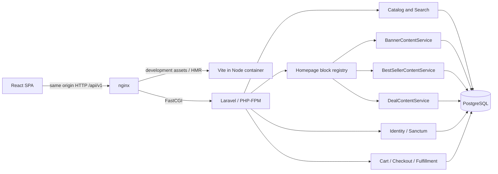

# Architecture

## Runtime and boundaries

Use a modular monolith: one Laravel deployment and one PostgreSQL instance, with explicit domain services. Separate microservices/databases would add operational work without improving this assignment. The homepage requirement is satisfied by a distinct backend service for each block type; sharing PostgreSQL does not mean sharing one hardcoded content array.



The foundation increment used an infrastructure standby server. Phase 2 replaces it with React/Vite and installs the Laravel REST entry point. Production will compile Vite into static files served by nginx; Node remains a Docker build stage and is not an extra public runtime server. All dependencies and build tools run in containers.

## Code organization planned for phase 2 onward

```text
backend/app/
  Http/Controllers/Api/V1/   # HTTP orchestration only
  Http/Requests/            # input validation
  Http/Resources/           # explicit public representations
  Models/                  # Eloquent relations, casts, scopes
  Policies/                # cart/order ownership
  Services/Catalog/        # queries, facets and public offers
  Services/Search/         # normalizer, candidate generator, ranker
  Services/Homepage/       # registry + independent block providers
  Services/Checkout/       # transaction, idempotency and fulfillment
frontend/src/
  app/                     # routing and providers
  features/                # catalog, search, home, auth, cart, orders
  components/              # shared UI
  lib/api/                 # typed REST client and error mapping
```

Controllers use Form Requests, application services and API Resources. Eloquent owns persistence; do not add generic repositories that merely wrap it. Use transactions for business invariants, policies for authorization, structured logs with request IDs, eager loading to avoid N+1 queries, and bounded pagination.

React uses React Router, a typed fetch client and TanStack Query for server state. Search/filter/sort/page live in URL parameters. Local component state handles presentation. A small local guest cart stores offer IDs and quantities only; after sign-in, merge through the API and revalidate availability. No prices or keys are trusted from browser storage. Search debounces approximately 250 ms, aborts stale requests and exposes loading/empty/error states.

## Authentication

Implemented identity slice: see [phase 3A notes](modules/03-authentication.md). Auth routes explicitly run web session middleware even when Origin/Referer is absent; duplicate Sanctum stateful middleware is excluded. Sanctum accepts cookie sessions only. Strict token validation overrides Laravel 13's same-origin Fetch Metadata shortcut. Rate limits persist in a file store for this single-instance dev deployment. The following paragraphs describe the broader authentication/deployment design.

Sanctum stateful SPA authentication with session cookies; do not store bearer tokens in localStorage. Frontend and API share nginx origin. First fetch `/sanctum/csrf-cookie`, then send cookies and URL-decoded `XSRF-TOKEN` as `X-XSRF-TOKEN` on unsafe requests, including login/register. Rotate the session on login, invalidate/regenerate the CSRF token on logout. Return JSON for API failures. Limit registration/login attempts. Phase 2 installs Sanctum; phase 3 wires `statefulApi()` and authenticated routes. No wildcard credentialed CORS policy is required for same-origin use.

Production needs HTTPS, Secure/HttpOnly session cookies, trusted proxy configuration, `APP_DEBUG=false`, a unique persistent APP_KEY and a restrictive CSP tested against the final UI. Session-domain and stateful-origin settings must match the actual deployed hostname. Database users have only application privileges; PostgreSQL and FPM are never published to the host.

## Homepage composition

`GET /home` returns ordered block metadata from `homepage_blocks` and content resolved by provider. `BannerContentService` reads active campaign banners. `BestSellerContentService` ranks fulfilled order items in a documented 30-day window (seed completed demo orders to make this visible). `DealContentService` selects available offers with a genuine discount against reference price. The product collection mapping is shared, but each provider owns its query and content. Unknown block types are rejected when configuring data; the frontend uses an allowlisted component registry. Each block has a typed payload and status; a failed block returns an empty payload and an error status while other blocks render. No browser HTML injection from CMS strings.

## Search

Normalize case/whitespace and Unicode; allow 2–100 characters for queries. Bound output to 20 suggestions. Rank exact title, prefix, substring, then fuzzy results; use stable ID tie-breaking. Parameterize SQL and escape LIKE wildcard characters. Trigram candidates and application edit distance provide typo tolerance; full-text search alone does not.

Store unique normalized title trigrams in `product_search_grams`, refreshed with product changes. Use indexed gram overlap to shortlist at most 100 candidates; rank those with a bounded Unicode-aware edit-distance implementation in PHP. Short two-character queries use prefix/substring only; never fetch the full catalog into PHP. Test long titles, diacritics, repeated letters, partial names and misspellings. Cap query work and measure with EXPLAIN and a larger generated dataset. An external search engine is a future upgrade only.

## Purchase transaction

1. Require authenticated user, CSRF and `Idempotency-Key` (UUID). Validate `simulate_result` against an enum; payment is explicitly a fake, synchronous provider with no network calls.
2. Start a PostgreSQL transaction. Serialize checkout for this user with a user-row lock, then find `(user_id, idempotency_key)`. Matching stored request hash returns the existing order; reuse with different input returns 409. The hash covers the canonical request body; the existing result is returned even if the cart has since been cleared.
3. Lock the cart and its items; lock all referenced offers in ascending ID order. Recalculate prices from the database. Require the client-observed cart revision; a stale cart or unavailable/changed offer returns 409 with a refreshed-cart instruction, without selling keys. A cart line stores the last acknowledged price for comparison, never pricing authority.
4. For success, lock enough unsold key rows per offer in ascending ID order. All purchases must follow this offer/key lock order. If any line cannot be fulfilled, roll back the whole checkout and return 409. Create immutable order/item price snapshots and the payment attempt; mark keys sold with their order item. No floating point arithmetic.
5. For a simulated decline, persist a failed order/payment with snapshots but allocate no keys; retain the cart. Retry with the same idempotency key returns the same decline. A new attempt uses a new key.
6. On success mark order fulfilled and clear cart within the same transaction, then commit. Database deadlocks may retry the entire transaction up to three times. Reveal keys through owner-only endpoints after commit, never in listing or checkout logs. Decline, rollback and lost-response tests must verify these boundaries.

This synchronous demo avoids inventory reservations and asynchronous payment inconsistencies. A real provider requires a separate pending/reservation workflow, signed webhook verification and reconciliation; it cannot be substituted without redesign.

## Security and operational constraints

Encrypt demo key values with Laravel encrypted casts (TEXT storage) and use a keyed HMAC fingerprint for duplicate prevention. Key HMAC secret is separate from APP_KEY; keep both stable and backed up. Never serialize ciphertext or fingerprints to public endpoints. Fetch keys only for a fulfilled order owned by the requester, return `Cache-Control: no-store`, and exclude key data from logs/errors/analytics.

Seeded ratings and discount reference prices are demonstrative, not claims about real sellers. Restrict image URLs to seeded trusted origins; later uploads require separate validation. Redact passwords, cookies, payment details and keys from diagnostics. Public catalog uses rate limits; authenticated writes have stricter limits. Keep demo payment endpoints disabled outside explicitly configured demo deployments.

## Sources and compatibility

- [Laravel 13 release notes](https://laravel.com/docs/13.x/releases) and [framework composer.json](https://raw.githubusercontent.com/laravel/framework/13.x/composer.json) confirm PHP `^8.3`; checked 2026-11-17.
- [Sanctum SPA authentication](https://laravel.com/docs/13.x/sanctum) documents cookie/CSRF authentication.
- [Vite guide](https://vite.dev/guide/) documents supported Node versions. The requested latest stable Node Docker image will be verified during bootstrap, with resolved versions recorded.
- [Compose startup ordering](https://docs.docker.com/compose/how-tos/startup-order/) explains readiness conditions used by the infrastructure.
