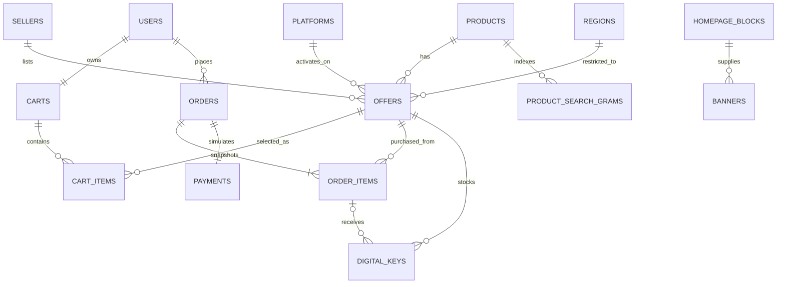

# Database design

Current database: **PostgreSQL 17**, changed from MySQL by explicit user request on 2026-11-23. PostgreSQL is used in local Docker, tests, production rehearsal and Render's free managed database. The original MySQL volume/data are preserved, not overwritten.

The domain migration selects `backend/database/schema/marketplace.pgsql.sql` for PostgreSQL and retains the original MySQL artifact only for existing legacy installations. The PostgreSQL schema preserves all 14 domain tables, foreign keys, monetary checks and inventory constraints, with identity sequences and explicit indexes. Standard Laravel migrations install users/sessions and shared cache/locks. [schema.sql](schema.sql) is a review artifact; run Laravel migrations for setup, never import both copies.

Search uses case-insensitive parameterized matching, bounded trigrams and application edit-distance ranking. SQL `CASE` preserves relevance order; PostgreSQL `NULLS LAST` keeps sold-out products last in both price directions. Checkout retains transactions, user/offer/key row locks, stock checks and idempotency; the two-process race is validated on PostgreSQL.

## Relationships

## Entities and constraints

| Table | Purpose and key constraints |
|---|---|
| users | Unique email; Laravel password hash; verified timestamp; account timestamps |
| sessions | Database-backed Sanctum session; indexed user/activity; standard Laravel payload |
| password_reset_tokens | Standard Laravel reset token schema; reset UI is future scope |
| sellers | Unique slug, display name, demo rating stored as hundredths of a star (0–500) |
| products | Unique slug, title, description, cover, release date, publication state |
| platforms / regions | Stable code and display name; region includes activation explanation |
| offers | Product/seller/platform/region identity; EUR integer minor-unit price, optional reference price, active flag; multiple keys per offer |
| digital_keys | Encrypted key, unique HMAC fingerprint, offer; optional order-item assignment; no duplicated stock counter |
| carts | Exactly one per user by unique FK; monotonically increasing revision |
| cart_items | Unique cart/offer; quantity 1–10; observed price for changed-price handling |
| orders | Public UUID, user, status, EUR total, UUID idempotency key and request hash; unique user/key |
| order_items | Immutable title/seller/platform/region/price snapshots, quantity and line total; references original offer |
| payments | One synchronous simulated attempt per order; amount, status, non-sensitive fake reference |
| homepage_blocks | Unique key, provider type, title, ordering, enabled flag, optional time window |
| banners | Associated banner block, text, image, internal target path, ordering and activation window |
| product_search_grams | Composite `(gram, product_id)` PK for candidate lookup; reverse index for reindexing |

Seller rating column is `rating_hundredths`, range 0–500; API emits a decimal 0–5. No aggregate review system is implied.

## Invariants

- Money is unsigned integer cents plus explicit `EUR`; no float prices. Limit each unit price to 10,000,000 cents, quantity to 10 and cart lines to 50 at the API layer; order totals fit unsigned BIGINT. SQL checks enforce positive quantities and line arithmetic.
- Platform and region belong to an offer, because competing sellers may offer different activation variants. Filter predicates must match a single offer, rather than mixing platform from one and price from another. Product-card minimum price comes from offers matching the active filters, with inventory available.
- Published products remain browsable when sold out; their minimum price is null and availability is false. An active availability filter excludes them. Price filtering necessarily excludes records without a purchasable matching offer.
- A key is available exactly when `order_item_id IS NULL`. Assignment occurs only under checkout locks. A purchased quantity must equal assigned keys before the order becomes fulfilled. No nullable composite unique constraint is used to model single ownership.
- Cross-table rules (key's offer equals item's offer; payment/order totals agree; fulfilled order has sufficient keys) are enforced by the checkout service in one transaction and verified by PostgreSQL integration tests.
- Order items remain immutable even if an offer price/title changes. Prevent deletion of referenced sellers/products/offers; deactivate instead. Do not cascade-delete order history or sold keys.
- Guest carts are local IDs/quantities until merged through authenticated APIs. Merging is bounded, takes a cart lock, combines quantities up to 10 and returns warnings for dropped/unavailable offers.
- Cart revision increments on every mutation, including acknowledgment of a changed price. `checkout` rejects an old revision; idempotent replay is checked before revision validation.
- SQL times are UTC `TIMESTAMP(6) WITHOUT TIME ZONE`; API dates are ISO 8601 UTC. Application inserts timestamps explicitly. Client local time is presentation only.
- Product title n-grams are derived data, replaced transactionally when title/publication changes. Seeded bestsellers derive from fulfilled demo orders, not a fabricated frontend list.

## Index strategy

Indexes cover public slug lookup, offer dimensions and price, available keys `(offer_id, order_item_id, id)`, cart ownership/lines, `(user_id, created_at, id)` history, order status/time for bestseller aggregation, block ordering, banner windows and n-gram candidate lookup. Test with realistic multi-offer cardinality and `EXPLAIN`; do not assume the presence of an index guarantees the final filter/sort plan.

Laravel sessions are included. Sanctum cookie authentication does not require personal access tokens; add that table only if token clients become in scope. The deployment increment adds standard `cache` and `cache_locks` tables in migration `2026_11_22_000002` for shared production cache and rate limiting across recycled instances. Development can retain its existing array/file stores. Checkout remains synchronous, so no database queue tables or worker are required.
