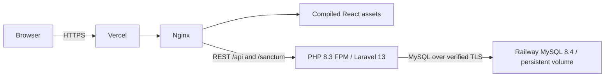

> Historical MySQL/Vercel deployment notes, retained for reference; commands require adaptation to the current PostgreSQL stack. The current target is [Render](deployment.md).

# Deployment runbook

Target selected on 2026-11-22: **Vercel Container Runtime for the application, Railway for persistent MySQL**. Public provisioning is pending account connections. No public URL, remote CI result, remote database, or cloud backup has been verified yet.

## Architecture



nginx and PHP-FPM run under Supervisor in the same unprivileged application container. React is compiled with the latest Node image during the build; no Vite development server runs in production. Browser API calls remain on the same HTTPS origin, preserving Sanctum's cookie/CSRF flow. MySQL sessions, cache and rate-limit counters survive application recycling and are shared between instances. Filesystem state is disposable; the application currently accepts no uploads and uses synchronous simulated payments.

[Vercel's current Laravel guide](https://vercel.com/kb/guide/laravel-php-with-docker) uses FrankenPHP. This project retains the required nginx/PHP-FPM stack using the [container runtime](https://vercel.com/docs/functions/runtimes/container), which accepts an HTTP-serving OCI image. `vercel.json` selects the final `vercel` stage in `docker/php/Dockerfile` through its container service entrypoint. Builds always use the repository root as context. Vercel currently documents container support as beta; validate availability and resource limits in the selected account before release.

## Files and secrets

| File | Purpose |
|---|---|
| `vercel.json` | Vercel container service and same-origin routes |
| `docker/php/Dockerfile` | Development, production FPM and combined Vercel targets |
| `docker/vercel/` | Rootless nginx, process supervision and runtime template rendering |
| `.env.vercel.example` | Variables to configure in Vercel; no real credentials |
| `compose.vercel.yaml` | Local rehearsal with a separate persistent MySQL container |
| `compose.production.yaml` | Alternative Docker-server deployment with separate nginx/FPM services |
| `scripts/initialize-release.ps1` | Generate independent local release secrets without printing them |
| `scripts/backup-database.sh` | Transaction-consistent local Compose database dump |

Keep real environment files and dumps untracked. `.dockerignore` excludes local secrets, vendor/node modules, local Laravel bootstrap caches and backups. Persist `APP_KEY` and `KEY_FINGERPRINT_SECRET` separately from the database backup: changing them breaks encrypted key delivery/fingerprints. Never generate these secrets automatically during startup. Preview deployments need separate secrets and a separate database; do not attach arbitrary previews to production data.

## Railway MySQL provisioning

1. Connect the Railway account and select an available free/trial allowance or an explicitly authorized plan. Create one project with a `mysql:8.4` service and a persistent volume mounted at `/var/lib/mysql`.
2. Configure a new database `marketplace`, dedicated application user `marketplace`, and independent random application/root passwords through service secrets. With the official image, use `MYSQL_DATABASE`, `MYSQL_USER`, `MYSQL_PASSWORD`, and `MYSQL_ROOT_PASSWORD` on the **first initialization of an empty volume**. Later variable changes do not rotate existing database accounts.
3. Vercel is outside Railway's private mesh. Enable Railway's [public TCP proxy](https://docs.railway.com/databases/mysql), then use its public hostname and assigned proxy port in Vercel `DB_HOST` and `DB_PORT`. `*.railway.internal` cannot be used from Vercel.
4. Configure MySQL TLS with a certificate valid for the public hostname and a trusted CA. Supply the CA as `MYSQL_SSL_CA_BASE64` (base64 PEM); the entrypoint creates a private temporary CA file and sets Laravel's `MYSQL_ATTR_SSL_CA`. Verify the server identity and `SHOW SESSION STATUS LIKE 'Ssl_cipher'` from the actual application connection before opening the demo. Railway's TCP proxy alone is not proof of encrypted/verified MySQL transport. Certificate setup and remote TLS verification remain pending account access; do not silently disable verification.
5. Select a nearby Vercel/Railway region pair. Confirm connection limits against the total application instances and six FPM workers per instance. Restrict runtime credentials to this application database. Retain a separately controlled migration credential if DDL access is removed from the runtime user.
6. Configure backups and retention supported by the selected tier; export a logical backup off the database host and test restoration. Free/trial resource and lifetime limits must be checked in the actual account. See [Railway free-plan limits](https://docs.railway.com/pricing/free-plan); free hosting is not a guarantee of permanent availability.

## Vercel release

1. Connect Vercel, import `https://github.com/Ankitbajgain/eneba`, and use the repository root. Ensure the production branch includes these release files. Use the Container preset/service from `vercel.json`; leave framework build/output overrides empty. Enable container support if the account requires it.
2. Add all variables from `.env.vercel.example` to **Production** settings. `PORT=8080` is required for this rootless container. Set the final HTTPS `APP_URL`, hostname-only `SANCTUM_STATEFUL_DOMAINS` (include a port only for nonstandard ports), blank `SESSION_DOMAIN`, and `SESSION_SECURE_COOKIE=true`. Set `TRUSTED_PROXIES=*` only behind Vercel's controlled public ingress. `APP_DEBUG=false` is enforced at startup. The fingerprint secret and application key must remain stable across releases.
3. Set the dedicated MySQL credentials and verified TLS CA from Railway. No database or root password belongs in frontend variables or build arguments. Database cache/session drivers are required; array/file stores are unsuitable for recycled instances.
4. Build the release image locally or in a trusted release runner:

   ```powershell
   docker build --target vercel -f docker/php/Dockerfile -t eneba-vercel:production .
   ```

5. Create an ignored `.env.vercel` using the example and secret-manager values. Run migrations once as a separate release action, then seed the fictional catalog on the initial deployment:

   ```powershell
   docker run --rm --env-file .env.vercel --entrypoint production-entrypoint eneba-vercel:production php artisan migrate --force
   docker run --rm --env-file .env.vercel --entrypoint production-entrypoint eneba-vercel:production php artisan db:seed --force
   ```

   These commands connect to the remote database. Do not migrate or seed during image build or application startup. Seeding is explicit; it upserts demo content without replenishing sold keys. Use the exact image/source version intended for deployment.
6. Deploy through the connected Vercel account, Git integration, or authenticated `npx vercel@latest deploy --prod`. Confirm that the actual build uses the `vercel` target (last Dockerfile stage), not the private FPM-only target.
7. Verify HTTPS `/api/v1/health`, SPA deep links, static assets, registration/login/logout, Secure/HttpOnly session cookies, CSRF enforcement, typo search, seller offers, declined/successful demo checkout, order ownership and key delivery. Verify an existing session/order/key after instance recycling. Make the demo accessible to reviewers through the project's deployment-protection settings. Record the real public URL, release commit, provider resource IDs, remote tests and backup evidence before marking delivery complete.

No real payment processor is configured. `DEMO_PAYMENTS_ENABLED=true` enables the clearly labelled fictional payment flow.

## Local Vercel-image rehearsal

This runs the production HTTP image with local MySQL; it does not publish to Vercel.

```powershell
powershell -NoProfile -ExecutionPolicy Bypass -File scripts/initialize-release.ps1 -AppUrl http://localhost:9080 -AllowLocalHttp
docker compose --env-file .env.production -f compose.vercel.yaml build backend release
docker compose --env-file .env.production -f compose.vercel.yaml up -d --wait database
docker compose --env-file .env.production -f compose.vercel.yaml run --rm release migrate --force
docker compose --env-file .env.production -f compose.vercel.yaml run --rm release db:seed --force
docker compose --env-file .env.production -f compose.vercel.yaml up -d --wait backend
```

Open `http://localhost:9080`. `-AllowLocalHttp` turns off Secure cookies **only for this loopback rehearsal**. The initializer refuses to overwrite existing secrets. To use another port, set `RELEASE_HTTP_PORT` and the origin/port in `APP_URL` and `SANCTUM_STATEFUL_DOMAINS` consistently. Existing development ports 5173/8000/8080 remain separate.

Optional browser acceptance (requires the isolated Playwright tools described in README):

```powershell
$env:MARKETPLACE_BROWSER_ORIGINS='http://localhost:9080'
$env:MARKETPLACE_ENV_FILE='.env.production'
$env:MARKETPLACE_COMPOSE_FILE='compose.vercel.yaml'
$env:MARKETPLACE_RESTART_CHECK='true'
$env:MARKETPLACE_RESTART_SERVICES='database,backend'
node scripts/check-marketplace-browser.mjs
```

The browser script cleans up only its generated test accounts/orders in the selected Compose database. Restart checks are opt-in and intended for the isolated rehearsal, never a live reviewer session.

## Backup, recovery and rollback

```powershell
docker compose --env-file .env.production -f compose.vercel.yaml run --rm backup
```

Dumps are written to ignored `.backups/` with restrictive container permissions and an atomic final rename. Copy backups to a separate protected destination; dumps contain personal data and encrypted key inventory. This Compose command backs up the local database only; for Railway use its backup/export tools or a matching MySQL client configured for the remote verified-TLS endpoint.

Test a dump by importing it into a **new empty recovery database**, comparing row counts and encrypted inventory, and booting the matching application image with the original secrets. For a MySQL-container recovery, copy the dump with `docker compose ... cp` and run the `mysql` client inside the database container; do not pipe SQL through PowerShell's text encoding conversion. Verify key decryption and ownership before switching the application to the restored database. Never import into an existing live database as a routine check.

Keep the previous tested image/commit. Roll back application images with stable secrets and a compatible schema. The new cache migration is additive. Avoid rolling migrations down on a live marketplace; incompatible database recovery requires a maintenance window and a tested backup, including reconciliation of any orders placed after that backup.

Application logs go to stderr; local Docker logs rotate. nginx `/healthz` is process/gateway liveness, while `/api/v1/health` includes database readiness and should drive release acceptance. For an existing Docker server, use `compose.production.yaml` behind an HTTPS reverse proxy targeting the loopback port, set the actual trusted proxy addresses and public cookie settings, and preserve the named MySQL volume. No source mounts or database host ports are used.
